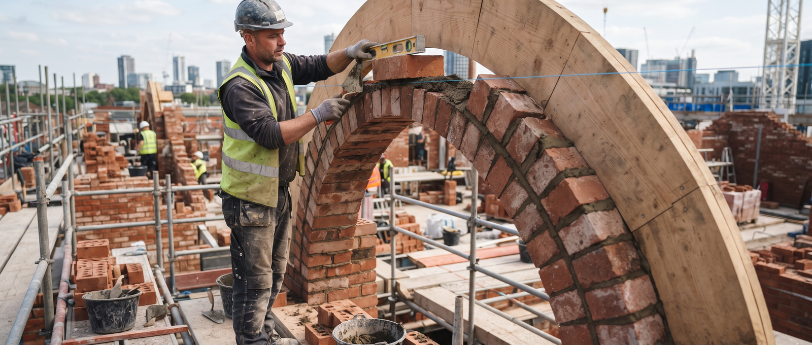

# cdd-configdrift-alertonschemaviolation




# cdd-configdrift-AlertOnSchemaViolation
Validates a configuration file against a JSON schema and alerts if the configuration violates the schema. Uses the `jsonschema` library.

> Desk notice: the alert in this tool is a printed error and an exit code rather than any message sent elsewhere. Its own verified behavior section narrows the promise to a printed validation error and an exit code of 1, and no alert channel is named in any section.


## Install
```
git clone https://github.com/ShadowGuard-AI/cdd-configdrift-alertonschemaviolation
cd cdd-configdrift-alertonschemaviolation
pip install -r requirements.txt
```


## Usage
```
python3 main.py [-f json|yaml] [-l LEVEL] CONFIG_FILE SCHEMA_FILE
```


## Parameters
- `CONFIG_FILE`: path to the configuration file (JSON or YAML).
- `SCHEMA_FILE`: path to the JSON schema file.
- `-h`: show help message and exit.
- `-f`, `--format`: format of the config file: `json` or `yaml`. Autodetects if omitted.
- `-l`, `--log-level`: logging level: `DEBUG`, `INFO`, `WARNING`, `ERROR`, or `CRITICAL`.

> Desk notice: the log level arrives with no default stated in the README. The notch is left unpainted rather than guessed at.


## Verified behavior
- A config with port 80 against a schema requiring a minimum of 1024 printed the validation error and exited 1.
- A config with port 8080 against the same schema printed "Configuration is valid." and exited 0.
- The same valid result was obtained with `-f json` given explicitly.
- A missing config file exits 1.


## License
MIT License, see LICENSE.
